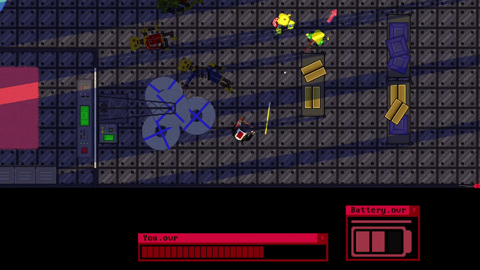

  

**OVERWRITTEN** is a single-player 2D action shooter set in a post-apocalyptic world, where the surviving robots form the only remaining societies. You play as robot who has to fight his way throught many enemies to take its revenge and reclaim its place in the world. Made in Godot 4.7 and written in GDScript.

  

## Game Features

- About 30 minutes of gameplay
- 4 levels
- 4 types of enemies
- 2 bosses
- 6 unique weapons
- Progress saving

## Download

Get the game from [Itch.io](https://golczewa.itch.io/overwritten) or the [Releases](../../releases) page. The game is a single executable file, so no installation is needed.

**Platforms:** Windows / Linux

## Building from source

Building is not recommended. (seriously, dont do that)
## Bug reports

Found a bug? Open an [issue](../../issues).

## Credits

- Game design, programming, art: [Golczewa](https://golczewa.itch.io)
- Music: [Tomality](https://tomality.itch.io)
- Testing: Kumarancza, lukimogger613, The Driver, Burgerowy, Golcrewg

## License

- **Code** (scripts only): [MIT](LICENSE)
- **Graphics and pixel art:** © 2026 Golczewa. All rights reserved. They may not be copied, modified or redistributed without permission.
- Music is used under its author's license: [Tomality](https://tomality.itch.io)